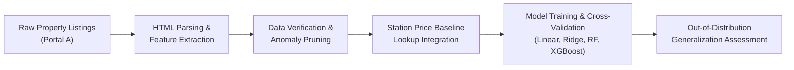

# Tokyo Rental Price Prediction and Generalization

- **Unit**: Practical Machine Learning (`GCIS1` / Global CIS Special Lecture 1)
- **Study Period**: Fall 2025
- **Degree Programme**: Master of Computer and Information Sciences — Hosei University

All property listing samples evaluated in this study were originally sourced from Portal A (a leading Japanese rental real estate portal). This repository serves as a code-and-methodology archive containing the pipeline logic, feature engineering routines, and machine learning experiments in [`rental_price_prediction.ipynb`](rental_price_prediction.ipynb).

---

## Overview

This project presents an end-to-end machine learning study that predicts apartment monthly rental prices across the Koganei region of Tokyo and explores the **geographic out-of-distribution generalization** of tabular regression models. 

Starting from raw real estate listings, the project progresses through automated HTML parsing, categorical normalization, multi-dimensional anomaly detection, tree-based ensemble modeling, and regional market transfer validation.



---

## Key Methodologies and Engineering Highlights

### 1. Robust Feature Extraction and Normalization
- **Structural Attributes**: Normalized building structural materials (RC, SRC, Steel, Wood), building age derived from construction year, total usable floor area (m²), and unit layout classifications (1R, 1K, 1DK, 1LDK, 2K+).
- **Floor Dynamics**: Normalized property vertical positions into ground floor flags, top-floor indicators, total building stories, and target unit floor levels.
- **Commute Accessibility**: Parsed multi-station transit distances, extracting primary walking times (in minutes) to the nearest transit hubs.
- **Financial Structure**: Standardized monthly rent, common service fees (*kanrihi* / *kyouekihi*), and computed deposit (*shikikin*) and key money (*reikin*) ratios normalized against monthly base rent.

### 2. Data Cleaning and Outlier Detection
- Implemented `find_problem_ids()` to diagnose parsing mismatches and missing fields across variable HTML layouts.
- Developed `find_numeric_anomalies()` and rent density filters (Rent / Area) to filter non-residential units, commercial conversions, and recording anomalies that could distort gradient calculations.

### 3. Model Benchmark and Comparison
Trained and compared four distinct regression paradigms on the primary Koganei residential dataset:

| Model Architecture | Test RMSE (JPY) | Test R² | Validation Characteristics |
| :--- | :---: | :---: | :--- |
| **Linear Regression** | 19,133 | 0.861 | Baseline linear fit; sensitive to high-rent outliers |
| **Ridge Regression** | 15,715 | 0.906 | L2 regularized; reduced variance over unregularized OLS |
| **Random Forest** | 12,240 | 0.942 | Non-linear tree ensemble; captures floor-size interactions |
| **XGBoost Regressor** | **10,345** | **0.959** | Gradient boosted trees; superior residual fitting and lowest error |

### 4. Regional Domain Shift and Generalization
- **The Challenge**: A model trained solely on one station (e.g., Higashi-Koganei) suffered significant performance degradation (R² dropping from 0.96 to 0.15 ~ 0.76) when evaluated directly on adjacent train stations (Shin-Koganei, Hana-Koganei), illustrating severe geographical domain shift.
- **Station Baseline Prior**: To solve this, a metro-wide benchmark feature was integrated using an external lookup table encompassing 1,101 Tokyo train stations.
- **Logarithmic Target Transformation**: Applying log(1 + y) normalized right-skewed pricing distributions and stabilized residual variances.
- **Holdout Validation**: The generalized model was evaluated on unseen holdout stations (e.g., Hachioji, Musashisakai), confirming that spatial price priors effectively bridge inter-neighborhood price discrepancies.

---

## Repository Structure

```text
GCIS1-Rental-Price-Prediction/
├── .gitignore                     # Excludes raw datasets and checkpoint caches
├── README.md                      # Technical report, unit information, and architecture
└── rental_price_prediction.ipynb  # Complete end-to-end sanitized Jupyter Notebook pipeline
```

---

## Environment and Dependencies

The pipeline is implemented in Python 3.10+ and standard data science libraries:

```bash
pip install numpy pandas scikit-learn xgboost matplotlib seaborn
```

To run the analysis notebook:

```bash
jupyter notebook rental_price_prediction.ipynb
```

---

## Portfolio note

This Git repository was created retrospectively from the original project code, with assistance from OpenAI Codex and Antigravity in curating the repository and writing this README for publication. The initial commit timestamp is backdated to the original coursework submission date, followed by the final release commit.
